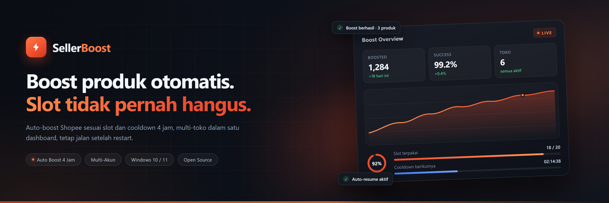

<div align="center">



# SellerBoost

**Otomatisasi boost produk Shopee untuk seller Indonesia — satu dashboard, banyak toko.**

[](https://github.com/airdrop-888/SellerBoost-Shopee/releases)
[](https://github.com/airdrop-888/SellerBoost-Shopee/releases)
[](https://electronjs.org)
[](LICENSE)
[]()

[Tentang](#tentang) · [Fitur](#fitur) · [Instalasi](#instalasi) · [Mulai Cepat](#mulai-cepat) · [Arsitektur](#arsitektur) · [FAQ](#faq)

</div>

---

## Tentang

Shopee memberi seller slot boost produk gratis dengan cooldown 4 jam. Masalahnya: slot itu hangus kalau tidak diklik tepat waktu — dan tidak ada yang mau bangun jam 3 pagi untuk klik boost.

**SellerBoost** adalah aplikasi desktop Windows yang mengurus itu otomatis. Jalankan sekali, biarkan berjalan di system tray, dan bot akan mem-boost produk sesuai slot, menunggu cooldown, retry saat gagal, serta lanjut sendiri setelah PC restart atau mati lampu.

Dibangun dengan Electron, berjalan lokal di komputer seller. Cookie dan data toko tidak pernah dikirim ke server mana pun.

---

## Fitur

<table>
<tr>
<td width="50%" valign="top">

**Otomasi**
- Auto boost sesuai slot & cooldown 4 jam
- Retry otomatis saat request gagal
- Auto-resume setelah restart / mati lampu
- Windows startup, jalan di background
- System tray, tanpa window mengganggu

**Operasional**
- Multi-akun: banyak toko, satu aplikasi
- Products catalog: harga, stok, terjual, status boost
- Orders to ship + timer urgensi (< 12 jam)
- Activity logs lengkap dengan timestamp

</td>
<td width="50%" valign="top">

**Analitik**
- Revenue, orders, visitors, conversion rate
- Performa 30 hari per produk yang di-boost
- KPI cards & hero boost card realtime
- Live console untuk memantau aksi bot

**Teknis**
- Auto-updater dari GitHub Releases
- Data persisten di `%APPDATA%\SellerBoost`
- Watermark build per penerima (opsional)
- Installer NSIS, install ke `C:\Program Files`

</td>
</tr>
</table>

---

## Instalasi

### Installer (disarankan)

1. Unduh **`SellerBoost-Setup-2.4.0.exe`** dari halaman [Releases](https://github.com/airdrop-888/SellerBoost-Shopee/releases)
2. Klik kanan → **Run as administrator**
3. Ikuti wizard: **Next → Install → Finish**
4. Buka SellerBoost dari shortcut Desktop

> Aplikasi belum memakai sertifikat code-signing komersial, jadi Windows SmartScreen bisa
> menampilkan peringatan. Klik **More info → Run anyway**. Ini normal untuk aplikasi indie.

### Build dari source

```bash
git clone https://github.com/airdrop-888/SellerBoost-Shopee.git
cd SellerBoost-Shopee
npm install
npm start          # mode development
npm run dist:nsis  # build installer ke folder dist-build/
```

**Requirements:** Node.js 18+, Windows 10/11 x64

---

## Mulai Cepat

```text
1. Login seller.shopee.co.id di browser
2. F12 → Application → Cookies → https://seller.shopee.co.id
3. Copy semua cookie (wajib ada SPC_CDS dan SPC_F)
4. SellerBoost → Accounts → Add Account → paste → Save
5. Boost Manager → pilih produk → Start Bot
6. Settings → aktifkan Windows Startup + Auto-Resume
```

Panduan lengkap dengan troubleshooting: **[docs/PANDUAN-PENGGUNA.md](docs/PANDUAN-PENGGUNA.md)**

---

## Arsitektur

```text
shoopeBoost-Premium/
├── src/
│   ├── main.js         Electron main process, IPC, tray, auto-updater
│   ├── bot-core.js     Engine boost, session handling, storage
│   ├── index.html      Dashboard SPA (dashboard, products, orders, analytics)
│   ├── style.css       Design system (dark theme, Shopee orange)
│   └── branding.json   Identitas produk / watermark build
├── build/              Icon installer
├── docs/               Panduan pengguna, keamanan, changelog
├── release/            Installer siap distribusi
├── tools/              build-release.ps1, generate-icon.js
├── index.js            Entry CLI
└── run.bat             Launcher silent
```

**Stack:** Electron 27 · Node.js · vanilla HTML/CSS/JS · Axios · electron-builder (NSIS)

**Alur data:**

```text
Dashboard (renderer)
      │  ipcRenderer.invoke
      ▼
main.js  ──►  bot-core.js  ──►  Shopee Seller API
      │            │
      │            └──►  %APPDATA%\SellerBoost  (cookies, stats, config)
      └──►  Tray / Auto-start / Updater
```

---

## Watermark Build

Setiap installer bisa diberi identitas penerima tanpa mengubah kode:

```powershell
.\tools\build-release.ps1 -Watermark "INV-2026-0117" -Owner "Nama Penerima" -Contact "wa.me/62xxx"
```

Watermark tampil di header dashboard: `SellerBoost v2.4.0 · INV-2026-0117`.
Tanpa parameter, build tetap bersih.

---

## Lokasi Data

```text
%APPDATA%\SellerBoost\
├── cookies.txt    session akun (lokal, tidak dikirim ke mana pun)
├── stats.json     riwayat & statistik boost
└── config.json    pengaturan startup & auto-resume
```

Folder ini **tidak** terhapus saat uninstall. Backup sebelum reinstall.

> Keamanan file sensitif dan prosedur kalau session bocor: **[docs/KEAMANAN.md](docs/KEAMANAN.md)**

---

## FAQ

<details>
<summary><b>Apakah password Shopee saya diminta?</b></summary>
<br>Tidak. SellerBoost hanya memakai cookie session yang Anda copy sendiri dari browser. Password tidak pernah diketik ke aplikasi.
</details>

<details>
<summary><b>Cookie berapa lama valid?</b></summary>
<br>Umumnya 7–30 hari tergantung aktivitas akun. Kalau status akun berubah jadi <i>Expired</i>, login ulang di browser dan update cookie.
</details>

<details>
<summary><b>Apakah aman untuk akun?</b></summary>
<br>SellerBoost hanya mengotomatiskan aksi yang bisa dilakukan manual di dashboard Seller. Tetap ada risiko perubahan kebijakan Shopee terhadap otomatisasi — gunakan dengan bijak dan pantau akun secara berkala.
</details>

<details>
<summary><b>Bot berhenti saat PC sleep</b></summary>
<br>Matikan sleep: <i>Settings → System → Power → Sleep = Never</i>. Auto-resume akan melanjutkan bot setelah bangun.
</details>

<details>
<summary><b>Antivirus memblokir installer</b></summary>
<br>Installer unsigned. Tambahkan folder instalasi ke exclusion, atau build sendiri dari source.
</details>

---

## Kontribusi

Issue dan pull request terbuka. Sebelum push, pastikan tidak ada file sensitif:

```bash
git status --short
git diff --cached --name-only | Select-String -Pattern "cookies|\.har|\.env|secret"
```

---

## Changelog

Lihat **[docs/CHANGELOG.md](docs/CHANGELOG.md)**.

---

## Lisensi

[MIT License](LICENSE) — bebas digunakan, dimodifikasi, dan didistribusikan dengan tetap menyertakan notice hak cipta.

<div align="center">
<br>
<sub>Dibuat untuk seller Indonesia · Bukan afiliasi resmi Shopee</sub>
</div>
